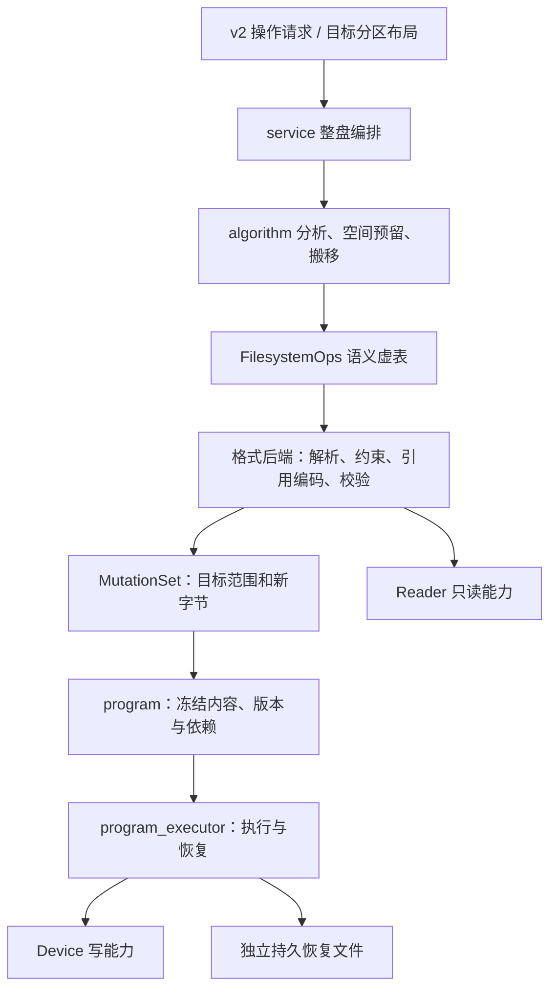

# 存储语义、整盘规划与恢复

更新：2026-10-25。生产维护入口执行 v2 存储请求，编译并执行不可变物理程序。镜像设备仅用于测试与验收；正式入口提供经过准入检查的 Linux 物理块设备写入，不提供镜像编辑功能。ext2/3/4、FAT32（协议名称 `vfat`）、NTFS 和 Btrfs 共六个格式入口使用相同语义虚表。XFS、exFAT、F2FS、NILFS2、UDF 继续报告未实现。

## 调用关系与所有权



- `Device` 表示介质；`Reader` 和 `Device` 各有虚表。公开 `read(allocator, io, range)` 返回调用者释放的字节，内部流式及 C ABI 使用有界 `readInto`。只有执行器持有可写能力。
- `core/maint/devices.zig` 管理维护任务的设备获取与句柄生命周期，执行器通过 `Provider` 获取 `Device`。默认提供者在打开路径前拒绝镜像请求，物理请求由 `storage/block_device.zig` 获取和核验。写能力仅在独立恢复介质准入后启用。
- `storage/testing/image_device.zig` 是测试专用的普通文件实现。测试提供者负责排他打开、身份与容量核对；算法、执行和恢复继续使用正式实现。
- `Partition` 保存稳定分区标识及当前范围，提供受检地址换算。`setRange / setSize` 返回规划请求，保持当前视图不变。视图摘要包含当前几何，分区表中的稳定 ID 不包含当前几何。
- `partition_table.Driver` 用虚表提供 `readLayout / validateLayout / encodeLayout`。支持 GPT 和 MBR 主分区；保留身份、名称、属性及未修改项，拒绝 EBR、扩展分区、混合布局、重叠和矛盾表。
- `Filesystem` 是绑定分区视图的格式会话。没有另一个混合设备与文件系统语义的 Volume，也没有通用文件内容 `read/write`。

设备、分区和文件系统会话均为借用对象；调用者必须让上下文存活至工作结束。测试普通文件的身份由文件系统 fsid、inode 和可获得的创建时间派生，能够在维护重启后重新校验；路径本身不作为身份。

## 物理设备准入

`BlockDevice` 只接受真实 Linux 块设备，拒绝普通文件和 device-mapper、MD、loop 等虚拟拓扑。身份优先使用 WWID，否则组合硬件序列号与设备信息；USB 桥不提供可读 SCSI VPD 时使用最近 USB 设备的厂商、产品、序列号、接口与 LUN。缺少稳定身份时拒绝。设备路径和 major/minor 不作为持久身份；分区目标另绑定起点和容量，联合调整则使用根盘及分区表身份。

执行与克隆源使用 `O_EXCL` 独占打开，并检查挂载、swap、holders、slaves 和设备几何。整盘任务检查所有子分区；分区任务允许不重叠的兄弟分区保持使用。读写统一走 `O_DIRECT` 与对齐的 64 KiB 缓冲区，避免整盘与分区的缓冲别名。每次写入及同步前重新验证硬件身份、容量、扇区、只读状态与恢复介质。相关 Linux 语义见 [open(2)](https://man7.org/linux/man-pages/man2/open.2.html)。

恢复目录必须是私有目录（不向组或其他用户开放），位于独立物理磁盘上的 ext4、XFS 或可证明单设备的 Btrfs。tmpfs、网络文件系统、未知拓扑、同盘其他分区及多设备 Btrfs 均拒绝。准入失败时不创建界面日志或恢复记录，不修改目标。Btrfs 的 backing 通过 FS_INFO 与 sysfs 设备枚举核对；目录的 O_PATH 句柄会重新打开为可执行 ioctl 的目录句柄。

整盘布局请求只能绑定根块设备。提交后重新读取内核分区表；失败时保留已提交状态并报告 degraded，不能报告成功或回滚已经提交的程序。SIGINT/SIGTERM 在安全边界请求取消，主进程等待物理恢复完成后以 130 退出；SIGKILL 后依赖下一次启动的持久记录恢复。

## 统一语义虚表

`semantic.FilesystemOps` 的协议不含任何第三方结构：

| 接口                              | 返回与责任                                                     |
| --------------------------------- | -------------------------------------------------------------- |
| Driver.probe/open、close、inspect | 打开、释放会话，查询格式、容量、特性、能力                     |
| enumerateObjects                  | 文件、目录及内部元数据的身份、种类、大小                       |
| enumerateAllocations              | 物理范围、所有者、搬移粒度、固定位置、分组与副本约束           |
| describeGeometry                  | 目标合法容量、格式固定保留范围                                 |
| requirements                      | 分配单元与新增元数据的空间、边界、对齐要求                     |
| encodeChanges                     | 根据已经选定的位置编码引用、分配结构及新记录，返回 MutationSet |
| check、verify                     | 当前检查与最终格式验证                                         |

`filesystem.Registry` 仅保存统一的 Driver：`detect` 自动识别，`get` 按类型选择，格式化选择驱动时不探测空白介质。Driver 生命周期虚表只包含 `probe/open`；打开后的查询、检查、遍历、布局约束、编码与验证均经过 `FilesystemOps`。已经删除 `adapter.zig`、第二套查询/检查虚表和修改操作的转发包装；格式后端内部直接调用本格式的解析函数，不再反向依赖注册表。只读 probe 输出的注册数量字段为 `registered_filesystems`，未实现格式的原因是 `driver_missing`。格式私有的 inode、MFT、FAT 链和树节点只在相应后端内解释。对象标识不依赖文件名，恢复不依赖对象标识或文件句柄。

文件不是唯一搬移单位：分配位图、目录块、inode 表、MFT、日志、树节点、保留区及副本同样必须描述。Btrfs 以整个 chunk stripe 为搬移单元，保持其内部逻辑地址及共享 extent 引用不变，DUP stripe 带共同分组。NTFS 分别描述命名流和系统文件的实际簇范围，重建位图作为生成型分配单元。

`ReadSet` 包装后端的只读访问，记录摘要并捕获重复读取发生的变化；编码输出携带这些证据。编译器检查目标、范围、读取守卫和新内容。后端只提供新字节，执行器在实际写入前读取旧字节并建立 undo。

## 共用算法与后端边界

`algorithm.prepare` 查询能力和合法几何，枚举分配单元，优先保留合法原位置，再通过 `space.Space` 分配剩余位置。新增元数据以稳定需求 ID 追加，禁止修改已有需求；最多 64 轮，超限或空间不足在目标修改前失败。伪后端契约测试单独证明规划器能够搬移内部对象、响应新增空间需求并拒绝不收敛要求。

`algorithm.append` 将选定映射变成明确的保护、搬移与写入。一个阶段的所有搬移源先保存，再覆盖目的地；共享算法负责选址与物理次序。后端不返回自行选择的搬移步骤。局部元数据修改按扇区合并，保留未修改字节；不同阶段的修改显式绑定输入版本。

格式化共用几何与预留流程，后端生成该格式必需的记录；修复保留各格式原有保守检查范围。缩容枚举越界和受目标布局影响的单元，生成新映射、引用、分配及容量记录。扩容分配新增元数据并编码布局，不能仅改一个容量字段。

第三方代码只提供格式定义、受控只读访问及确定性的记录/校验辅助：

| 格式     | 当前实现                                                                                                                                                                             |
| -------- | ------------------------------------------------------------------------------------------------------------------------------------------------------------------------------------ |
| ext2/3/4 | Zig 计算分组、超级块、位图、inode 表、根目录、lost+found 和日志布局；共用规划器选择搬移位置，后端重编码块引用及 inode 引用，使用 libext2fs 的记录和校验辅助。未链接 resize2fs 核心。 |
| FAT32    | Zig 编码 BPB、FAT、FSInfo、根目录，重编码簇链、目录首簇、容量与 hidden sectors。FatFs 仅提供 Unicode 大小写转换；不再构建 ff.c、挂载会话或磁盘回调。                                 |
| NTFS     | Zig 构造 NTFS 3.1 的系统记录和初始索引，解析并重编码 runlist、MFT/MFTMirr、位图和引导记录；复用 libntfs-3g 只读访问及固定编码数据。未构建 mkntfs/ntfsresize 的完整算法。             |
| Btrfs    | Zig 创建、遍历及编码 SINGLE/DUP 元数据、chunk 映射、设备 extent 和超级块；库仅提供格式与 CRC32C 支持。                                                                               |

低层记录编码有时需要可读的内存副本及 `mutation.MutationBuilder`，这些写入仅生成 MutationSet。它不是后端自行修改真实设备的通道，也不是执行一次完整上游缩扩容算法。没有宿主命令回退路径。测试中的 e2fsck、resize2fs、mtools、ntfsresize、ntfsfix、btrfs check/restore 等只用于构造夹具和独立验收。

## 不可变物理程序

`program.Program` 使用 v7 显式二进制编码和 SHA256，冻结设备身份、请求摘要、格式能力及特性摘要证据、读集、步骤内容、数据版本和依赖。上限为 16,384 步、64 MiB 编码内容。执行器重新解码编码后的内容，以这些字节为权威，拒绝字段与摘要不符的输入。

物理步骤包括 SaveScratch、RestoreScratch、Write、流式 Copy 和 Barrier，第一版按明确顺序执行。搬移源可指定前序阶段版本；需要回溯的旧版本通过持久 before-image 重建。覆盖、循环和自重叠先转成持久保护步骤；不能从已经 discard 的历史版本恢复数据，编译阶段拒绝这种程序。

`service.layout` 对一个可写根设备生成一个事务。例如可用区域内 A `[0,50)`、B `[50,100)` 变成 A `[0,80)`、B `[80,100)`：

1. 读取并验证分区表、两个文件系统、目标几何及能力，完成全部规划。
2. B 在旧起点缩到前 20，疏散越界对象并修改引用、位图与容量。
3. 保存**缩容后的 B 数据版本**，将有效分配及格式保留范围移到 `[80,100)`。未分配残留无需复制；重编码与分区起点有关的字段。
4. B 的恢复来源已经持久保护后，A 使用新范围并扩容。
5. 验证文件系统，再分别更新分区表记录。GPT 备份表、备份头、主表、主头分别持久记录。
6. 验证最终布局和文件系统，发布唯一整盘提交标记。

请求使用精确字节数和分区标识；不默默取整。上例用相对比例说明流程；默认稀疏镜像验收使用 500/500 MiB → 800/200 MiB，数据区前另留 1 MiB 分区表空间。支持一个可写根盘，可再持有一个只读克隆源，不提供多个可写磁盘的联合提交。

## Undo、持久暂存与恢复

独立恢复文件包含 `program / snapshots / scratch / state / ready / commit / restored`。`recovery_store.Store` 的文件创建、预留、读写、文件同步、原子发布与目录同步全部经过虚表，生产实现与掉电模型执行同一套协议。

执行前核对身份、几何、独占条件、读集和克隆源守卫；为 before-image、暂存槽、进度槽预留实际文件空间。普通文件后端使用 fallocate，空间不足不修改目标，不只创建稀疏逻辑长度。

每步遵循：保护步骤前状态并同步/校验 → 持久意图 → 写目标 → 刷盘和读回校验 → 持久完成。当前实现保守保存每次非 discard 目标写入的旧内容，包括搬移目的地；同时保留搬移源暂存，允许安全覆盖与逆向恢复，不仅凭“这是 Move”省略保护。正文按 64 KiB 流式处理，持久暂存文件容量与内存峰值分开约束。

状态使用 v6 校验块，绑定执行程序摘要及步骤号；意图、完成、恢复完成分占不同的恢复块，防止追加记录损坏前一个已经同步的记录。标记采用临时文件、文件同步、原子发布和目录同步。恢复先验证记录序列和所需快照，再按反向步骤恢复每一步执行前状态；再次恢复具有幂等性。

没有提交标记的事务默认回滚，不重新运行文件系统算法。已提交标记保留最终状态；取消在有界写入边界停止并进入恢复。格式化及克隆的明确目标写入允许 discard，失败后属于未完成输出；普通缩扩容和修复不得 discard。原有效数据、元数据及布局受保护，原未分配空间的残留内容没有恢复承诺。

生产、硬件入口及所有存储验收均调用当前 `program_executor`，只支持 v7 程序及 v6 恢复记录。产品尚未上线，不承担旧协议兼容。旧计划、事务执行器、恢复解码器、单阶段编译器、内存冻结克隆及其测试包装已删除；执行和恢复仅有一套实现。测试故障注入集中于 `testing/executor.zig`，包装真实 Device、恢复 Store 和 Observer，不提供另一套存储算法。

`mutation` 集中定义字节修改及记录编码视图，后端输出只有明确的新字节和读集。`memory` 管理资源限制；`Device.Reader.digest` 负责有界摘要读取，供克隆守卫、内容校验和执行读回使用。克隆流程及最终验证归入 `service`，不保留独立的 `clone.zig`。

恢复与暂存仍使用独立持久介质上的文件后端，没有新增裸恢复分区。镜像测试的文件可以放在临时测试介质；这些结果不证明真实硬件的掉电行为。

## 生产请求与界面

`core/proto/contract.json` v2 区分请求、编译摘要及执行状态。请求绑定目标稳定身份，选择已有分区时使用 partition_id；联合调整传入各分区目标字节范围。维护进程独占打开目标后完成最终规划并持久保存程序，界面展示真实步骤及十进制字节进度，已取消任务等恢复结束后才退出。

```sh
# 正式程序只读查询系统、设备几何与格式能力
pizza-maint --probe
pizza-maint --storage-capabilities
pizza-maint --probe-device /dev/disk/by-id/DEVICE

# 物理请求使用 probe-device 返回的身份与逻辑扇区大小
pizza-maint --execute --plan request.json --journal-home /persistent/job --no-ui --exit-after-plan

# 单独构建镜像验收入口；默认产品构建不安装该程序
zig build maintenance-fixture -Doptimize=safe
pizza-maint-fixture --probe-image /absolute/disk.raw
pizza-maint-fixture --execute --plan request.json --journal-home /persistent/job --no-ui --exit-after-plan
```

下面是物理分区格式化请求。identity 必须替换为 `--probe-device` 返回的真实摘要；路径须是可访问的绝对设备路径。此操作明确替换目标原内容。只读 probe 不占用写能力，也不替代执行前的准入检查。测试镜像请求使用独立的 fixture 程序、`kind: "image"` 和镜像身份；正式程序拒绝镜像目标，报告 `ImageTargetsUnsupported`。

```json
{
  "id": "format_partition",
  "version": 2,
  "request": {
    "operation": "create",
    "filesystem": "vfat",
    "target": {
      "path": "/dev/disk/by-id/DEVICE-part1",
      "identity": "<64 位小写十六进制摘要>",
      "sector_size": 512,
      "kind": "physical"
    }
  }
}
```

交接验证请求摘要，物理程序与其恢复标记绑定实际执行程序摘要。恢复目录已有事务时先处理旧事务；不同请求不能冒充旧事务成功，收到 `RecoveryRequestMismatch` 时不会执行新操作。显式 `recover` 请求不需要原文件系统库状态或克隆源。恢复目录必须按任务独立保存。

界面事件日志负责显示；物理恢复记录决定介质恢复。即使界面日志损坏、缺少最后一个完成事件，也必须处理物理日志。后台工作持有恢复目录和目标句柄，关闭界面或取消后仍等待安全恢复。诊断 `--self-test` 和 TUI 绘制夹具允许使用模拟数据；固定模拟步骤及故障参数不再是生产执行选项。

## 能力与资源边界

- ext 的检查与修复范围保持 allocation_metadata，验证超级块、组描述符、位图、分配计数及校验。修复不冒充完整 e2fsck；未知特性、bigalloc 等不支持组合继续拒绝。
- FAT32 检查包含目录和完整簇链，修复确定的辅助记录及可安全归属的孤儿链；歧义、交叉链等情况拒绝猜测。
- NTFS 3.0/3.1 检查已分配 MFT、runlist、簇所有权、分配位图、镜像、引导、休眠与日志状态；修复只重建确定损坏的备份引导。脏卷、待重放日志、歧义主副本不自动修复。检查范围不是完整 chkdsk。
- Btrfs 限定单设备 SINGLE/DUP，验证分配树、节点、映射及镜像；多设备、RAID、zoned、待重放日志、未知特性等继续拒绝。移动整个 chunk，不实现 chunk 分裂、balance 或内核全部压缩空间能力；需要 B-tree 分裂或涉及固定超级块 stripe 时在修改前失败。
- 元数据、对象索引及编码内容仍需内存，不能宣称任意大卷都能规划。资源上限、无法表达的结构变化或不支持的特性在写入前失败。

内存控制器读取系统及 cgroup v2 可用量，固定安全余量 `max(512 MiB, 有效总量 / 10)`，另预留库工作区与恢复工作区。共用 Zig 分配器按页计费，读取、写入及刷盘继续检查压力；C 库内部 malloc 不在精确计费范围，依赖单独预留和可用量检查。压力证据锁存，不能因之后内存回升把失败改判通过。`--storage-memory` 输出预算。采样并不证明任意两个采样时刻之间不存在瞬时峰值。

## 验收

```sh
zig build test -Doptimize=safe
zig build test-storage -Doptimize=safe
zig build test-filesystems -Doptimize=safe
zig build test-storage-crash -Doptimize=safe
zig build test-backend -Doptimize=safe
zig build check fmt-check -Doptimize=safe
zig build test-executor -Doptimize=safe -- --bundle PATH --kernel-version 7.2.11-arch1-1
zig build test-executor-physical test-executor-physical-4kn -Doptimize=safe -- --bundle PATH --kernel-version 7.2.11-arch1-1
zig build test-transition -Doptimize=safe -- --bundle PATH --kernel-version 7.2.11-arch1-1
```

共用测试覆盖六个格式入口的查询、创建、修复、缩扩容、克隆和独立检查；语义套件直接运行新物理程序，联合调整覆盖 36 种 A/B 组合、尾部有效数据、目录和内部元数据，并有总数据区 1000 MiB 的稀疏镜像用例，保持精确的 50/50 → 80/20 比例。GPT 测试分别中断表与头的写入并验证原始两份布局恢复。

掉电模型区分可见与持久状态、文件同步与目录同步，覆盖丢失、重排、撕裂、垃圾写入及 I/O/空间不足。新执行和恢复均枚举持久化边界，恢复后再次掉电、重复恢复。独立进程套件当前 120 轮，在规划前、计划完成、真实写入及自然提交阶段发送 SIGKILL，恢复进程也会被终止；它运行新执行器并用独立工具及文件内容核对结果。SIGKILL 不清空宿主页缓存，因此不能替代掉电模型。

QEMU 镜像 executor 与 kexec/transition 在一次性测试镜像中注入独立的 `pizza-maint-fixture` 入口。另有 `test-executor-physical` 与 `test-executor-physical-4kn` 使用正式 `pizza-maint` 和独立虚拟块设备，覆盖 512/4096 字节扇区、同盘恢复介质拒绝、取消恢复及跨启动恢复。原始 bundle 保持不变。executor 用例执行真实镜像请求，覆盖成功、身份拒绝、写入中 SIGKILL、界面日志损坏和删除克隆源后的跨启动恢复；kexec/transition 用例使用真实格式化请求和动态步骤数，核对原盘哈希、恢复报告及内存采样。基础层保持签名验证，不为测试绕过信任检查。

生产物理写入须经过上述准入；格式特性白名单及离线实验的设备授权范围仍受限制。私有镜像、模型及 VM 验收不等于真实设备反复断电认证。

六格式在固定 USB 分区上的单分区操作与恢复矩阵已完成，每种 28 项，另有初始化和清理；使用原生块设备目标及独立检查工具。见[2026-10-25 实盘报告](hardware-filesystems-2026-10-25.md)。真实分区表保持不变；联合分区调整和 4096 字节扇区继续由既有镜像/VM 套件验收。
