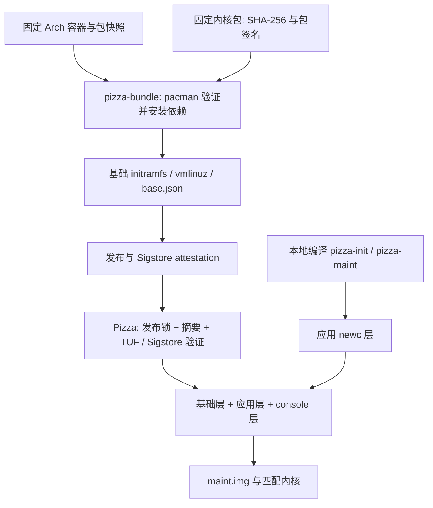
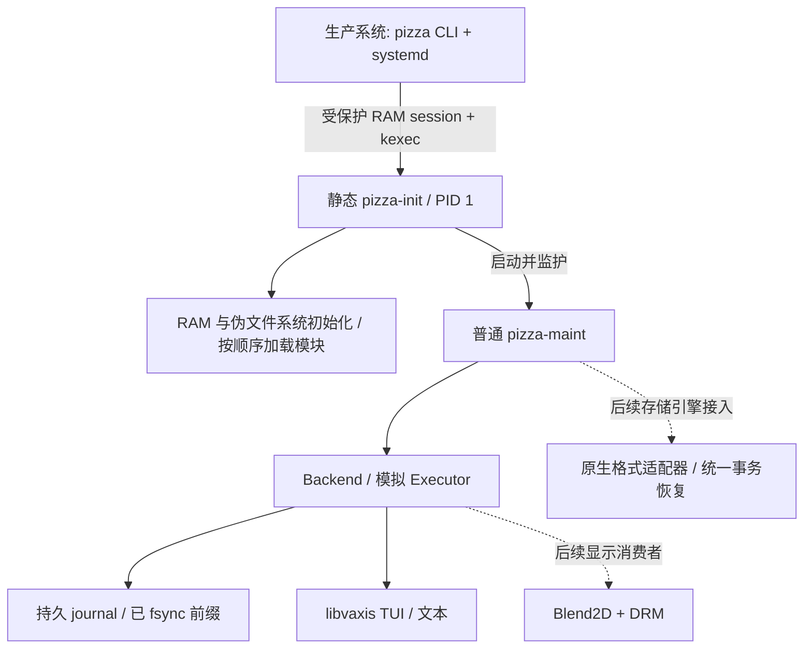
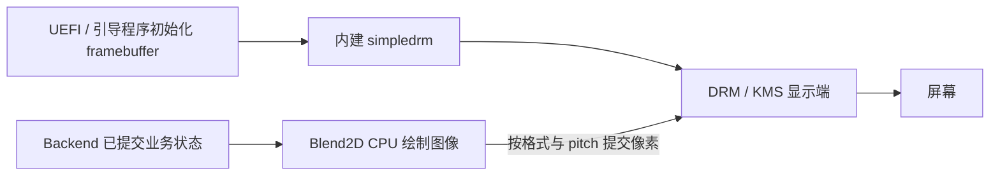

# Pizza 维护环境架构与启动切换设计

初始设计：2026-10-13。修订：2026-10-21。
本文定义当前架构，取代早期的宿主内核收集、浏览器界面和 dracut 组装方案。
实施顺序与验收状态见 [维护环境实施计划](../plans/2026-10-21-pizza-maintenance-plan.md)。

## 1. 目标与当前边界

Pizza 在 RAM 维护环境中执行预先确认的任务，通过生产系统的 systemd/kexec 路径进入该环境。
当前任务执行仍为 20 步模拟；已经打包文件系统工具，不代表真实格式化、修复、扩缩容或恢复操作已经接入。

当前显示使用 libvaxis TUI 和文本输出。维护网页、WebKit/WPE、JS/native bridge、Mesa/EGL 和浏览器 sandbox 支持已移除。
后续图形界面采用 Blend2D CPU 绘制与 DRM 显示；该路径尚未实现。
正常系统中的分区任务规划界面、Windows 支持、独立 UKI/ISO 和 Secure Boot 签名链也属于后续工作。

| 决策           | 当前选择                               | 约束                                                   |
| -------------- | -------------------------------------- | ------------------------------------------------------ |
| 运行环境生产者 | 独立 `pizza-bundle` 仓库               | 第三方包、内核、模块、固件策略和基础镜像均在生产者维护 |
| 内核           | 固定 Linux 7.2.11 / `7.2.11-arch1-1`   | 镜像与模块来自同一个已验证包，不依赖宿主安装的内核     |
| 基础镜像       | 显式输入树经标准 cpio/gzip 打包        | 不使用 dracut，不扫描宿主硬件、运行库、驱动或固件      |
| 维护进程       | 静态 PID 1 + 普通动态应用              | PID 1 负责环境与监护；业务和 journal 由应用持有        |
| 当前显示       | TUI / 文本                             | 图形能力不得成为执行和 journal 的前提                  |
| 生产 journal   | 独立物理磁盘上的 ext4 与私有目录       | 原根不作为维护端的可写日志存储；复杂拓扑明确拒绝       |
| 测试           | 本地单元/集成、scratch 容器、QEMU/OVMF | 基础包验收、完整应用切换、发行版矩阵和实机验收分别记录 |

## 2. 两仓库与信任边界



### 2.1 pizza-bundle 的职责

- 固定官方 Arch 构建容器 digest、包快照，以及内核包 URL、版本与摘要。
- 用 pacman 验证包签名并解析传递依赖，保留运行库、资源、许可证和必要的包配置。
- 用 patchelf 设置相对解释器和 `$ORIGIN` RUNPATH；生产者持有第三方 ELF 重定位逻辑。
- 从固定内核镜像提取实际配置，从配套模块树解析依赖、解压模块并生成加载顺序。
- 打包基础 initramfs；基础层没有 `/init`，也不含 Pizza 应用。
- 验证运行库隔离、目录移动、工具启动、fs 插件依赖及基础镜像启动，随后发布产物与来源证明。

生产输入由 `config/packages.txt`、`config/kernel.json`、`config/maintenance.json` 和
`config/filesystem-tools.json` 定义。构建从干净的包安装树开始，不复制宿主 `resolv.conf`，也没有宿主收集回退入口。
构建工具可以在固定构建环境中运行；其运行不等于将构建环境的已安装运行库收进维护包。

### 2.2 Pizza 的职责

`config/bundle/release.json` 固定发布仓库 ID、workflow、tag、commit，以及三个基础产物的 SHA-256。
消费端先验证摘要与来源，再检查 `cpu-maint-v1` 接口，复制原始基础层并加入本次编译的应用。
TUF 信任材料、Fulcio 身份策略、DSSE、Rekor 与 SCT 验证属于构建侧；细节见 [依赖与发布](../../dependencies.md)。

消费端不重新解析上游软件包、不重定位第三方 ELF、不调用 dracut/depmod/modprobe，也不重新审计上游逐文件内容。
本地 `manifest.json` 描述应用接口和入口；它不是对后续任意修改的发布签名。

当前发布锁固定正式发布的 [v0.4.1](https://github.com/Pizza-Partition/pizza-bundle/releases/tag/v0.4.1)，
源提交为 `d6729057a02482852274427ecfaa2580161ee448`。三个产物已通过摘要与原生 Sigstore 验证，并组装成当前应用镜像。
修改生产者源码不会更新已发布产物；后续升级仍须先发布，再更新真实摘要和来源约束。旧浏览器 profile 继续拒绝。

### 2.3 布局和启动约定

```text
pizza-base-x86_64.img    # 已验证的原始基础层
vmlinuz                 # 同次发布的固定内核
base.json / release.json / attestation.json
manifest.json           # 本地应用入口与 cpu-maint-v1 接口
overlay/
  init
  opt/pizza/bundle/bin/pizza-maint
```

基础层中的运行环境位于 `/opt/pizza/bundle`。启动动态程序前必须进入 bundle 根目录，
使 `PT_INTERP=lib/ld-linux-x86-64.so.2` 正确解析；RUNPATH 相对于 `$ORIGIN`。
包内工具的 `/bin/sh`、常规命令路径和 `/etc` 配置由 RAM 镜像提供。
部署目录是镜像布局约定，不是 ELF 的绝对安装前缀。

最终 `maint.img = 原始基础层 + gzip/newc 应用层 + console 层`。无需打包网页资源或 panel 别名。

## 3. 进程所有权与业务状态



`pizza-init` 挂载 RAM 与内核伪文件系统、检查 RAM 根、解析非秘密启动选项、加载模块、启动应用并回收直接或孤儿子进程。
它不执行计划、不持有业务后端、不自动重试任务。初始化失败、panic 或普通应用退出时，
先结束并回收子进程、同步并卸载持久挂载，再尝试重启；收尾或电源操作失败则进入受监护的 root 救援 shell。
救援中的 `reboot`、`poweroff`、`halt` 是上游 BusyBox 命令，PID 1 兼容其标准信号约定。
自有程序的最终电源调用集中在 `core/init/`；不剥夺操作者的 `CAP_SYS_BOOT`，不拦截上游命令的 `-f` 模式。
流程及新救援基础包的发布边界见 [init recovery](../../init-recovery.md)。

`pizza-maint` 是动态链接 glibc 的普通应用。Backend、Executor、journal 和 TUI 位于同一进程，
通过本地调用共享状态，不再存在浏览器消息方法、网络 API 或 JS 绑定生成步骤。
`core/proto/contract.json` 仍是计划、事件与 journal 布局的唯一来源，生成 Zig 类型并检查漂移。

TUI 初始化或绘制失败时，应用可以关闭仪表盘并保留文本诊断；执行器与持久化逻辑不依赖显示成功。
整个应用进程崩溃则会中断业务，PID 1 存活不表示任务继续执行。恢复通过 journal 判定，禁止自动重跑已有日志。
未来图形后端也必须遵守这一边界；不能把同进程崩溃描述成仅显示降级。

`--execute` 只启动全新的模拟计划；`--journal` 提供只读查看。`--no-ui` / `--no-tui` 提供控制台运行方式。
生产 `--session` 从受保护 RAM 文件读取并校验计划、设备身份与交接信息，应用负责挂载被授权的日志设备。

## 4. 固定驱动、固件与文件系统工具

### 4.1 内核配置与模块

生产者从实际内核镜像提取配置，要求以下选项内建：

```text
CONFIG_EFI=y
CONFIG_EFI_STUB=y
CONFIG_SYSFB=y
CONFIG_SYSFB_SIMPLEFB=y
CONFIG_DRM=y
CONFIG_DRM_SIMPLEDRM=y
CONFIG_EXT4_USE_FOR_EXT2=y
```

`simpledrm` 已在固定内核中内建，不需要额外加载 `simpledrm.ko`。
其他选定模块及硬、软依赖仅从显式包根解析，解压为 `.ko` 后写入 `/etc/pizza/modules`。
PID 1 按该清单装载，与 `/etc/pizza/kernel-version` 对照；缺失包、越界模块路径和版本不匹配均拒绝。

通用配置包含 virtio、NVMe、AHCI/SCSI、USB 存储/UAS 与控制器、USB/PS2 输入，以及文件系统和 NLS 支持。
文件系统清单为 ext2、ext3、ext4、Btrfs、XFS、NTFS、NTFS3、MSDOS、VFAT、exFAT、F2FS、ISO9660、UDF、
SquashFS、EROFS、OverlayFS、HFS、HFS+、NILFS2，共 19 种。ext2/3 由固定内核的 ext4 兼容支持提供。
这些能力不扩大生产 journal 的设备或文件系统选择范围。

### 4.2 固件策略

当前通用配置的外部固件清单为 `[]`，不是从宿主探测后得到的动态结果。
生产者检查所选驱动与模块依赖的固件声明；出现声明时构建失败，必须先设计固定包来源的专用硬件配置。
不为 simpledrm 引入原生 GPU 驱动固件，也不默认打包 Wi-Fi/蓝牙等固件集合。
UEFI/GOP 已初始化 framebuffer 与 Linux 外部固件文件是不同概念；前者不能通过复制宿主 firmware 目录代替。

### 4.3 原生存储引擎与旧基础包工具闭包

2026-10-22：应用已移除 libblockdev 调用、C 翻译和链接依赖，采用统一 Zig 格式适配接口及事务恢复核心。ext2/3/4 后端使用 Zig 从固定源码编译的 libext2fs，并通过 translate-c 接入只读能力。接口与验收见 [文件系统引擎](../../filesystems.md)。下表仅记录已发布旧基础包的输入；生产者清理后须重新发布并更新锁。

| 文件系统 | 生产者包输入                    | 工具范围                                               |
| -------- | ------------------------------- | ------------------------------------------------------ |
| Btrfs    | `btrfs-progs`                   | mkfs、检查、查询、调优与扩缩容所需命令                 |
| ext2/3/4 | `e2fsprogs`                     | mke2fs/mkfs 别名、e2fsck、tune2fs、resize2fs、dumpe2fs |
| XFS      | `xfsprogs`                      | mkfs、repair、admin、growfs、db、spaceman              |
| FAT/VFAT | `dosfstools` + `libblockdev-fs` | mkfs、fsck、fatlabel；`vfat-resize` 由 fs 插件包提供   |
| exFAT    | `exfatprogs`                    | mkfs、fsck、tune                                       |
| NTFS     | `ntfsprogs`                     | mkntfs、ntfsfix、ntfsresize、ntfslabel、ntfsinfo       |
| F2FS     | `f2fs-tools`                    | mkfs、fsck、dump、resize                               |
| NILFS2   | `nilfs-utils`                   | mkfs、tune、resize                                     |
| UDF      | `udftools`                      | mkudffs、udflabel、udfinfo                             |

精确包名与 40 个命令以生产者 `config/filesystem-tools.json` 为准；包清单覆盖和可执行路径在构建时检查。
libblockdev fs 插件、GLib 及其他传递运行库随包提供。内核 `ntfs` / `ntfs3` 与 NTFS-3G 的用户态工具集分别管理。
本次不需要 NTFS-3G 的 FUSE 挂载程序来满足这份工具清单。

隔离测试检查命令帮助入口能启动、真实插件可加载及 11 个技术项的依赖可用性。
这与真实设备上的格式化、修复和扩缩容正确性是不同验收层；存储引擎接入前仍需单独设计与测试。

## 5. 后续原生显示架构

目标数据路径：



渲染和显示是两项职责：Blend2D 生成 CPU 像素，DRM 后端负责输出设备、模式、dumb buffer 与提交。
不能假定 DRM 设备总是 `/dev/dri/card0`，也不能把图形初始化成功作为允许执行任务的条件。
字体、像素格式、pitch、缓冲生命周期、资源释放及 TUI 降级均在原生 GUI 阶段验收。
所需用户态库与字体届时由生产者显式加入；目前未接入 Blend2D，也不预装 Mesa/EGL 作为替代路径。

冷启动时的 UEFI framebuffer 可用，不代表 kexec 后仍可用。kexec 不重新执行固件或引导程序，
宿主原生 GPU 驱动可能已经改变显示状态。必须分别验证 UEFI 冷启动和真实生产 kexec 的显示交接；
QEMU 基础包启动、模块存在或 DRM 节点存在，都不能单独证明屏幕输出。
独立 UEFI/UKI 路线见 [启动镜像计划](../../boot-image.md)。

## 6. Journal 与恢复不变量

记录由固定 64 字节小端 header 与可变 payload 组成。准确 offsets 和 phase 数值以协议源为准：

| 字段                   | offset  | 类型              |
| ---------------------- | ------- | ----------------- |
| magic                  | 0       | u32，`0x505a4a31` |
| version / header_bytes | 4 / 6   | u16 / u16         |
| seq / monotonic_ns     | 8 / 16  | u64 / u64         |
| step_id / phase        | 24 / 28 | u32 / u8          |
| payload_len / crc32    | 32 / 36 | u32 / u32         |

其余 header 字节为保留区域；CRC 覆盖 CRC 字段置零后的 header 与 payload。
跨 boot 的 UTC anchor、boot ID、plan ID 和日志 home 位于 boundary payload，不能把 monotonic 值当作绝对 UTC。
JSON 事件的 seq 使用十进制字符串。

每个模拟步骤必须先写 intent 并 fsync，再开始工作；成功后写 commit 并 fsync。
界面只消费已经确认 fsync 的有效前缀。短写或 fsync 失败导致拒绝开始工作或停止后续步骤，不使用 RAM 日志替代持久化。
读取在第一个损坏或不完整记录处停止并报告尾部状态，不静默截断、修改或重跑日志。
仅有 intent 的步骤为 `in_flight`，不能推断成功、失败或自动恢复执行。

生产交接要求独立磁盘上的 ext4 与现有私有目录，核对设备关系、UUID、计划摘要、durable plan 和 loaded marker。
维护应用按 UUID 重新查找设备，拒绝重复身份，再以 `nosuid,nodev,noexec` 挂载日志存储；原根不在维护端挂成可写。
独立 `--execute` 的调用方可提供受支持的现有日志目录；它与生产 session 的自动设备选择和挂载边界不同。
详见 [生产交接](../../transition.md) 与 [约束说明](../../spec-clarifications.md)。

## 7. 失败语义

| 失败                             | 必须发生的行为                                            |
| -------------------------------- | --------------------------------------------------------- |
| 发布摘要、来源或 profile 不匹配  | 拒绝组装/使用基础包，不跳过验证                           |
| 模块缺失、越界或内核不匹配       | 拒绝初始化并保留 PID 1 诊断，不改用宿主模块               |
| kexec 加载被拒绝                 | 保留原系统运行，按状态机回滚/保留 staged 状态，不进入关机 |
| systemd 关机路径失败             | 尝试卸载已加载镜像并回滚 marker；报告失败                 |
| 受保护计划或日志设备身份校验失败 | 拒绝执行，不猜测设备或计划                                |
| journal 无法持久化               | 不开始相应工作或停止后续步骤，报告 degraded               |
| TUI 失败；后续图形显示不可用     | 应用保留后端与文本诊断；不改变持久化规则                  |
| 整个维护应用崩溃                 | PID 1 尝试受控重启；失败进入救援，禁止自动重跑计划        |
| 只有 intent，没有终结记录        | 报告 `in_flight`，不自动重试                              |

加载前允许经过验证的 staging 写入，不能把拒绝路径描述成“绝无任何状态变化”。
Secrets 经受保护 RAM 文件交接，不能写入 cmdline、持久 marker 或诊断日志。
Secure Boot/lockdown 拒绝与 EFI 签名链仍须实机验收；Sigstore 的发布来源证明不替代固件信任。

## 8. 验收层与当前证据

| 验收层                    | 当前证据或状态                                                                      | 不代表什么                                           |
| ------------------------- | ----------------------------------------------------------------------------------- | ---------------------------------------------------- |
| Pizza 单元/集成与后端自检 | 本地构建、协议检查、拒绝边界及回放自检通过                                          | 新完整应用镜像已经完成切换                           |
| 生产者工具隔离            | `v0.4.1` 发布流水线两次目录移动通过；40 个命令、11 个 fs 技术依赖检查、无包外库映射 | 每项存储操作已经在设备上正确执行                     |
| 生产者基础镜像            | `v0.4.1` 发布 QEMU 通过，27 个模块、19 种文件系统注册、动态 ABI 和 fs 插件检查通过  | simpledrm 已实际显示画面，或最终应用镜像已验收       |
| 新 profile 完整应用       | 当前工作树 + `v0.4.1`：维护监护、后端、执行故障恢复与完整 systemd/kexec/report 通过 | 发行版矩阵、实机、可见图形输出或真实磁盘操作已经通过 |
| 发行版与实机矩阵          | 夹具/程序和人工步骤存在，完整结果待运行                                             | 旧内核、Secure Boot、真实 GPU/控制器兼容性已通过     |

这些数量是当前固定输入的观测值，不是硬编码的永久支持上限。测试日志中的成功 marker 只证明对应验收层。
维护自检使用包内动态 coreutils `bin/true --version`，已验证动态执行、子进程回收及普通应用失败后 PID 1 继续存活。
自检不依赖浏览器 sandbox 工具。

测试命令与输出边界见 [测试说明](../../../test/README.md)。内存采样记录进程 RSS 合计和
`MemTotal-MemAvailable`；不覆盖源系统暂存峰值、PSS 或所有短时尖峰。4 GiB 是 VM 配置，不是已确定的产品预算。
真实硬件步骤见 [人工验收](../../manual-hardware-check.md)。

## 9. 仓库结构与实施顺序

```text
core/proto/        计划、事件和 journal 协议；生成 Zig 类型
core/transition/   暂存、kexec 加载、systemd 切换和只读 report
core/initramfs/    应用/console newc 层与基础镜像合并
core/init/         静态 PID 1、模块、监护与内存采样
core/maint/        普通应用、Backend、模拟 Executor 和 journal
core/session*     受保护交接、持久 marker、日志设备校验与挂载
core/bundle/      运行环境路径约束
build/bundle/     发布验证、应用 ELF 契约、overlay 组装和归档
ui/execution/tui/ 当前维护显示
ui/partition/     正常系统任务规划界面，尚未实现
tools/            宿主工程命令
test/             单元、集成、QEMU 与发行版矩阵
```

新基础包发布、消费锁与当前应用完整回归已完成。当前推进原生格式适配、受控数据搬移和统一恢复；旧 libblockdev 验收不计入新引擎能力，见 [文件系统引擎](../../filesystems.md)；原生显示与启动介质继续分别验收。
发行版、硬件和内存验证按各自证据推进，不因功能代码存在而自动标为完成。
具体依赖和验收清单以 [实施计划](../plans/2026-10-21-pizza-maintenance-plan.md) 为准。
